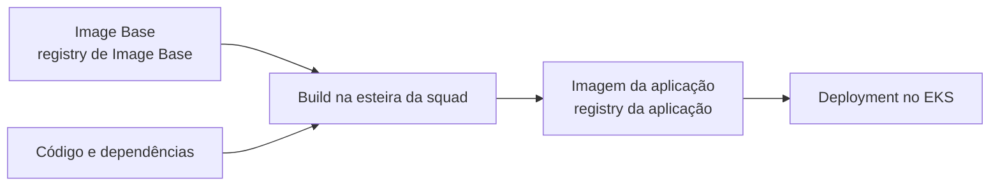

## Imagem base e imagem da aplicação {#imagens}

A imagem base entra no **build**. O EKS executa a **imagem final da aplicação**, construída e publicada pela esteira da squad.



- O Deployment referencia a **sua** imagem (`<registry-da-aplicacao>/<aplicacao>`), nunca um repositório `image-base-*`.
- Uma nova versão da base não altera Pods em execução, nem quando eles são reiniciados. A correção chega com rebuild, testes e um novo deploy. Veja [Atualizações e CVEs](../seguranca/atualizacoes.md).

## Configuração de segurança do container {#security-context}

A base define o usuário UID/GID `10000`. Raiz somente leitura e restrições de privilégio são configuradas no workload, não no Dockerfile. Exemplo de trecho do Pod:

```yaml title="spec.template.spec do Deployment (trecho)"
containers:
  - name: minha-app
    image: <registry-da-aplicacao>/minha-app@sha256:<digest>
    ports:
      - containerPort: 8080
    securityContext:
      runAsNonRoot: true
      runAsUser: 10000
      runAsGroup: 10000
      readOnlyRootFilesystem: true
      allowPrivilegeEscalation: false
      capabilities:
        drop: ["ALL"]
      seccompProfile:
        type: RuntimeDefault
    readinessProbe:
      httpGet:
        path: /<endpoint-de-saude>
        port: 8080
    livenessProbe:
      httpGet:
        path: /<endpoint-de-saude>
        port: 8080
    volumeMounts:
      - name: tmp
        mountPath: /tmp
volumes:
  - name: tmp
    emptyDir: {}
```

- Monte volumes graváveis somente onde a aplicação realmente grava; o trecho acima cobre apenas `/tmp`.
- Valide o trecho com os padrões e as políticas do seu cluster. Referência: [Kubernetes: security context](https://kubernetes.io/docs/tasks/configure-pod-container/security-context/).

## Probes {#probes}

Use probes `httpGet`, `tcpSocket` ou `grpc`. Probes `exec` executam um binário dentro da imagem, e o runtime não tem `sh`, `cat` nem `curl`: um `exec` com esses comandos sempre falha. Se precisar de `exec`, aponte para um executável que a própria aplicação fornece.

## Arquiteturas {#arquiteturas}

Se a imagem final tem as plataformas `linux/amd64` e `linux/arm64`, cada nó baixa a sua. Se tem só uma, restrinja o agendamento aos nós compatíveis:

```yaml title="spec.template.spec (trecho)"
nodeSelector:
  kubernetes.io/arch: arm64
```

Sem essa restrição, um Pod agendado em um nó de outra arquitetura falha com `exec format error`. Veja [amd64 e arm64](../referencia/arquiteturas.md).

## Encerramento {#encerramento}

O Kubernetes envia `SIGTERM` ao container e aguarda `terminationGracePeriodSeconds` (30 segundos por padrão) antes de encerrá-lo à força. Como o `ENTRYPOINT` executa a aplicação diretamente, sem shell intermediário, ela recebe o sinal: trate-o para concluir as requisições em andamento. Node.js e Python, por exemplo, ignoram o `SIGTERM` como processo principal do container se a aplicação não registrar um handler.

## Validar o deploy {#validar}

Use somente no namespace e no contexto autorizados:

```bash
kubectl rollout status deployment/<nome> -n <namespace>
kubectl get pods -n <namespace> -o wide
kubectl logs deployment/<nome> -n <namespace>
kubectl describe pod <pod> -n <namespace>
```

Se algo falhar, siga para [Debug no EKS](../troubleshooting/eks.md).
