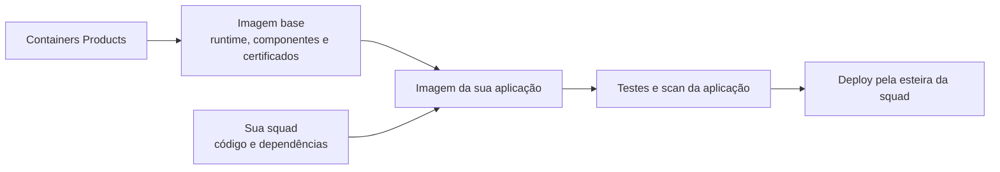

**Manter uma aplicação não deveria exigir que cada squad mantenha, sozinha, toda a base do seu container.**

## O problema {#o-problema}

Ao partir de uma distribuição genérica, o time também precisa decidir quais pacotes instalar, como disponibilizar o runtime, como tratar certificados e como acompanhar as atualizações dessa base. Image Base centraliza essa fundação e reduz a repetição dessas decisões entre squads.

| Sem uma base comum | Com Image Base |
| --- | --- |
| Cada squad escolhe e adapta sua fundação. | Existe um catálogo comum de runtimes e variantes. |
| Certificados e componentes básicos seguem estratégias diferentes. | A plataforma mantém o contrato da base e sua configuração de confiança. |
| Ferramentas de compilação podem acabar no container final. | O modelo separa a construção da aplicação da execução. |
| A origem e o conteúdo da base exigem controles próprios. | A base é publicada com identidade e evidências verificáveis. |

Isso não significa que imagens externas sejam necessariamente inseguras, nem que migrar seja apenas trocar uma linha. O ganho é consumir um produto de plataforma com responsabilidades, testes e distribuição padronizados.

## Como funciona {#como-funciona}

O Containers Products constrói as imagens base, executa verificações e testes e as distribui pelo Amazon ECR. Sua squad usa uma base no `FROM` do Dockerfile e acrescenta o código ou o artefato compilado.

**Image Base não é uma plataforma de deploy.** O produto não implanta seu serviço, não administra seus secrets e não atualiza automaticamente aplicações já construídas.

## O que você ganha {#beneficios}

| Benefício | O que muda para sua squad |
| --- | --- |
| **Manutenção centralizada da base** | Você não repete a composição do runtime e dos componentes básicos em cada projeto. |
| **Menos componentes desnecessários** | Shell, gerenciador de pacotes e ferramentas de compilação ficam fora da imagem final. |
| **Correções disponibilizadas pela plataforma** | Novas versões da base incorporam as correções disponíveis; sua aplicação as recebe ao ser reconstruída com a base atualizada. |
| **Confiança TLS padronizada** | O trust store da base é configurado no build e testado em Java, Go, .NET, Node.js e Python, sem ajuste no Dockerfile. |
| **Duas arquiteturas** | As bases contemplam `linux/amd64` e `linux/arm64`; sua aplicação ainda precisa ser construída e testada para a arquitetura de destino. |
| **Testes além do scan** | Os contratos verificam execução, versão, usuário do processo, filesystem e confiança TLS em cada família. |
| **Conteúdo e origem verificáveis** | Cada base é publicada com assinatura, SBOM e provenance. |
| **Um padrão de consumo** | Java, Go, .NET, Node.js e Python seguem a mesma convenção no Dockerfile. |

Ganhos de tamanho, desempenho e quantidade de vulnerabilidades devem ser medidos na sua aplicação migrada. Veja também o que a plataforma [valida e não garante](./seguranca/validacoes.md).

## Distroless e hardened {#distroless-e-hardened}

**Distroless** descreve o perfil mínimo do runtime: sem shell nem gerenciador de pacotes. **Hardened** acrescenta controles de segurança, manutenção e verificabilidade a essa base. Uma imagem Distroless não é automaticamente hardened, e uma imagem pequena, sozinha, não é garantia de segurança. Veja o [glossário](./referencia/glossario.md).
