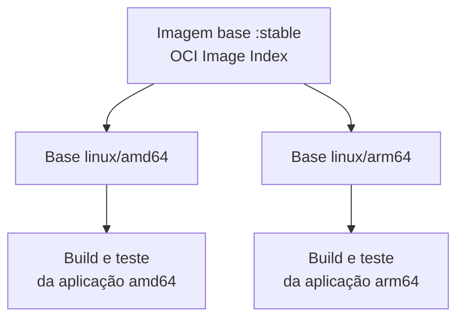

`amd64` é a arquitetura x86-64. `arm64` é a arquitetura ARM de 64 bits. Todas as imagens do catálogo são publicadas para `linux/amd64` e `linux/arm64`.

## Como funciona {#como-funciona}

Um **OCI Image Index** reúne as versões da imagem para cada plataforma. O cliente, como o Docker, o nó do EKS ou a task do ECS, seleciona automaticamente a versão correspondente à sua arquitetura. Veja [Docker: multi-platform](https://docs.docker.com/build/building/multi-platform/).



## A base multiarch não torna a aplicação multiarch {#aplicacao}

Bibliotecas nativas, wheels Python, addons Node.js, CGO, JNI e dependências .NET específicas precisam corresponder à arquitetura de destino. Cada arquitetura usada em produção precisa ser **construída e testada** pela esteira da squad: a presença da plataforma no índice não comprova que a aplicação executa nela.

A imagem final multiarch é publicada no registry **da aplicação**, nunca nos repositórios `image-base-*`.

## Verificar as plataformas {#verificar}

```bash
# Plataformas publicadas de uma imagem (requer acesso de leitura ao registry)
docker buildx imagetools inspect <registry-da-aplicacao>/minha-app:<tag>

# Plataforma de uma imagem local
docker image inspect minha-app:local --format '{{.Os}}/{{.Architecture}}'
```

Para testar outra arquitetura na sua máquina, veja [Ambiente local](../como-utilizar/ambiente-local.md#arquitetura).

## Escolher a arquitetura no destino {#destino}

- **Amazon EKS:** imagens com uma única plataforma precisam de `nodeSelector` com `kubernetes.io/arch`. Veja [Usar no Amazon EKS](../como-utilizar/eks.md#arquiteturas).
- **Amazon ECS:** no Fargate, `runtimePlatform.cpuArchitecture` define `X86_64` ou `ARM64`. Veja [Usar no Amazon ECS](../como-utilizar/ecs.md#arquitetura).
