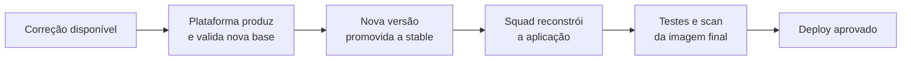

**O Trivy detecta. A atualização, a remoção ou a substituição do componente corrige.**

A plataforma incorpora as correções disponíveis nos componentes da base, produz e valida uma nova versão e então atualiza a tag `stable`. Esse processo **não modifica** imagens de aplicações já construídas.

## O novo build incorpora a correção? {#o-novo-build-incorpora-a-correcao}

**Somente se ele consumir a base corrigida.**

- Com `:stable`, o rebuild precisa consultar a versão atual da tag, como faz o `--pull` do Docker, em vez de reutilizar uma cópia antiga. `--no-cache` não substitui `--pull`. Veja [Docker: boas práticas de build](https://docs.docker.com/build/building/best-practices/).
- Com digest fixo, atualize o digest para o da nova versão promovida.
- Quando o build usa a variante `-dev`, a atualização precisa alcançar também esse estágio. Trocar somente o runtime não corrige vulnerabilidades incorporadas ao artefato durante a compilação.

**Reiniciar o Pod ou a task não reconstrói a aplicação.** Se a imagem final continua a mesma, uma nova versão da base não chega até ela.

## E se a aplicação ficar meses sem mudanças? {#aplicacao-sem-mudancas}

Ela continua com a base usada no último build. A squad deve definir um processo de adoção: revisão periódica, rebuild controlado ou automação aprovada que dispare o rebuild e os testes. Esse mecanismo não vem automaticamente com a adoção de Image Base.

| Onde está o problema? | Tratamento |
| --- | --- |
| Pacote ou runtime fornecido pela base | O Containers Products avalia e disponibiliza a base corrigida quando a correção existe. |
| Biblioteca adicionada pela aplicação | A squad atualiza a dependência e valida o uso. |
| Componente incorporado durante o build | A squad atualiza os insumos e o toolchain pertinentes e recompila. |
| Sem correção disponível | Registre o risco e siga o processo de análise ou exceção; não declare o problema resolvido. |

## Séries sem suporte do fornecedor {#series-sem-suporte}

Quando o fornecedor da linguagem encerra uma série, a plataforma não consegue incorporar correções que não são publicadas. Migre para uma série suportada, como no caso do [Go 1.25](../catalogo/index.md#go-1-25).

## Scan aprovado não é ausência de vulnerabilidades {#scan}

O scan da base trata separadamente as vulnerabilidades que ainda não têm correção disponível. Portanto, **scan aprovado não significa ausência de todas as vulnerabilidades conhecidas**, e a imagem final da aplicação precisa do próprio scan.
