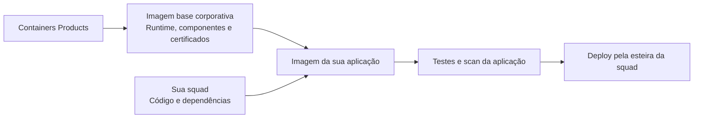
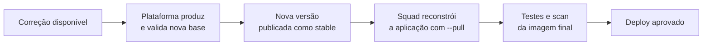
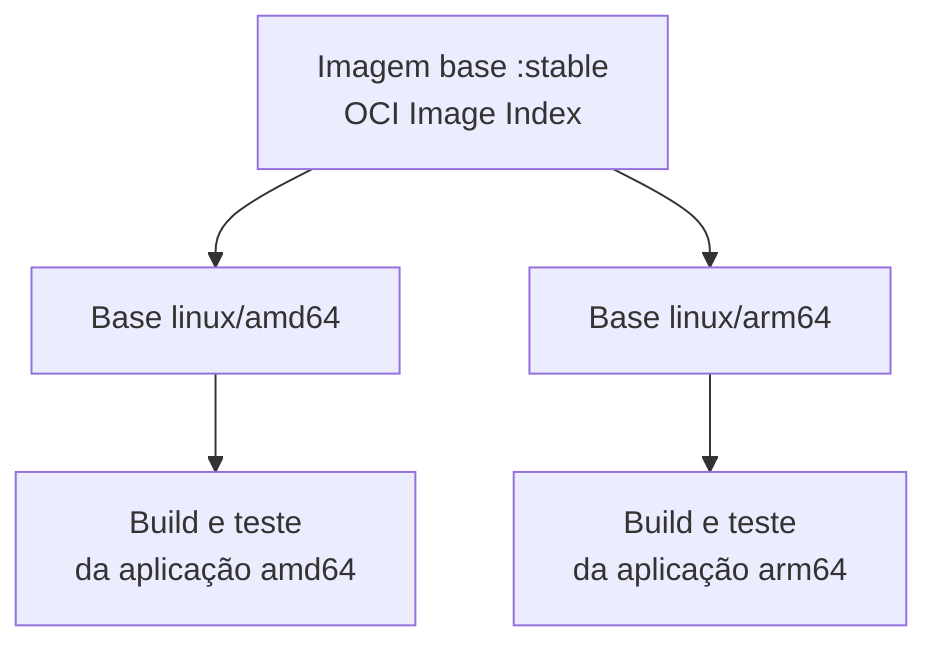

## 1. O que é a solução? {#solucao}

**Containers Products** constrói essas bases, executa verificações e testes e as distribui pelo **Amazon ECR**, o registro de imagens usado pelo produto. Sua squad consome uma base no `FROM` do Dockerfile e acrescenta seu código ou artefato compilado.



**As imagens base não são uma plataforma de deploy.** O produto não implanta seu serviço, não administra seus secrets e não atualiza automaticamente aplicações já construídas.

---

## 2. Por que usar as imagens corporativas? {#por-que-usar}

**Porque manter uma aplicação não deveria exigir que cada squad mantenha, sozinha, toda a base do seu container.**

Ao partir de uma distribuição genérica, o time também precisa decidir quais pacotes instalar, como disponibilizar o runtime, como tratar certificados e como acompanhar atualizações dessa base. As imagens corporativas centralizam essa fundação e reduzem a repetição dessas decisões entre squads.

| Sem uma base comum | Com a imagem base corporativa |
| --- | --- |
| Cada squad escolhe e adapta sua fundação. | Existe um catálogo comum de runtimes e variantes. |
| Certificados e componentes básicos podem seguir estratégias diferentes. | A plataforma mantém o contrato da base e sua integração de confiança. |
| Ferramentas de compilação podem acabar no container final. | O modelo separa construção da aplicação e execução. |
| A origem e o conteúdo da base exigem controles próprios. | A base vem com identidade e evidências verificáveis. |

Isso **não significa que imagens externas sejam necessariamente inseguras**, nem que migrar seja apenas trocar uma linha. O ganho é consumir um produto de plataforma com responsabilidades, testes e distribuição padronizados.

**Distroless** descreve o perfil mínimo do runtime, sem shell ou gerenciador de pacotes no perfil final previsto. **Hardened** acrescenta controles de segurança, manutenção e verificabilidade a essa base. Uma imagem Distroless não é automaticamente Hardened, e imagem pequena, sozinha, não é garantia de segurança. Veja o [glossário rápido](#glossario).

---

## 3. Glossário rápido {#glossario}

<details>
<summary>Ver os termos usados neste guia</summary>

| Termo | Significado |
| --- | --- |
| **Hardened** | Imagem mantida com foco em redução de superfície de ataque, conteúdo controlado, tratamento de vulnerabilidades, manutenção e evidências verificáveis de supply chain. |
| **Distroless** | Imagem orientada ao runtime, sem ferramentas gerais desnecessárias à execução, como shell e gerenciador de pacotes no perfil final. |
| **Slim** | Variante reduzida de uma imagem convencional. O termo indica redução de conteúdo, mas não define sozinho controles de segurança, manutenção ou supply chain. |
| **Scratch** | Ponto de partida vazio para uma imagem OCI. Tudo o que a aplicação precisa para executar deve ser fornecido explicitamente. |
| **Runtime** | Imagem destinada à execução da aplicação, sem o toolchain de desenvolvimento. |
| **`-dev`** | Variante destinada ao estágio de construção, contendo ferramentas como SDK, JDK, compilador ou npm conforme a família. |
| **`stable`** | Referência atualmente disponibilizada pelo Containers Products para consumo daquela família e versão. |
| **SBOM** | Inventário dos componentes presentes no artefato publicado. |
| **Assinatura** | Evidência verificável associada à identidade que assinou o artefato. |
| **Provenance** | Evidência verificável sobre a origem e o processo utilizado para produzir o artefato. |
| **CVE** | Identificador de uma vulnerabilidade conhecida. |
| **Multiarch** | Disponibilização da mesma referência de imagem para diferentes arquiteturas, neste produto `linux/amd64` e `linux/arm64`. |

Distroless e Hardened não são sinônimos. Distroless descreve principalmente o perfil mínimo do runtime. Hardening acrescenta controles sobre conteúdo, manutenção, vulnerabilidades, testes e verificabilidade do artefato.

Uma imagem slim pode ter menos componentes, mas tamanho reduzido, sozinho, não define uma postura de segurança.

</details>

---

## 4. O que você ganha? {#beneficios}

| Benefício | O que muda para sua squad |
| --- | --- |
| **Manutenção centralizada da base** | Você não precisa repetir a composição do runtime e dos componentes básicos em cada projeto. |
| **Menos componentes desnecessários** | Compiladores, shells e ferramentas de desenvolvimento ficam fora do estágio final quando não são necessários à execução. |
| **Correções disponibilizadas pela plataforma** | Novas bases podem incorporar patches disponíveis; sua aplicação passa a usá-las ao ser reconstruída a partir da tag `stable`. |
| **Certificados padronizados** | A integração de confiança da base deixa de ser uma solução improvisada em cada Dockerfile. |
| **Duas arquiteturas** | As bases do catálogo contemplam `linux/amd64` e `linux/arm64`; sua aplicação também precisa ser construída e testada para a arquitetura de destino. |
| **Testes além do scan** | Os contratos verificam execução, versão, identidade do processo, filesystem e confiança TLS conforme a família. |
| **Conteúdo e origem verificáveis** | A base é publicada com assinatura, SBOM e provenance, que registram o que foi publicado e sua origem. |
| **Um padrão de consumo** | Java, Go, .NET, Node.js e Python compartilham a mesma convenção de uso no Dockerfile. |

### Os termos de segurança, sem complicação

**CVE** é um identificador de vulnerabilidade conhecida. **Trivy** é o scanner: identifica vulnerabilidades e segredos segundo a política configurada; não aplica correções. **SBOM** é o inventário de componentes. **Assinatura** permite verificar a identidade de quem assinou o artefato. **Provenance** é uma declaração verificável sobre sua origem e produção.

**Não há promessa de zero CVE, compatibilidade universal ou prazo de correção não formalizado.** A base reduz componentes e centraliza controles, mas não substitui código seguro, scan da imagem final ou configuração segura do ambiente. Ganhos de tamanho, desempenho e quantidade de findings devem ser medidos na aplicação migrada.

---

## 5. Responsabilidades — matriz RACI {#responsabilidades}

**R:** executa a atividade. **A:** responde pelo resultado. **C:** é consultado. **I:** é informado. **R/A:** reúne execução e responsabilidade pelo resultado.

A matriz abaixo resume as responsabilidades no consumo das imagens base. Não substitui as atribuições formais de Segurança, PKI, Cloud ou dos responsáveis pelo ambiente de execução.

| Atividade | Containers Products | Pipelines Core (Artifactory) | Squad da aplicação |
| --- | :---: | :---: | :---: |
| Manter o catálogo e a composição das bases | **R/A** | — | I |
| Atualizar runtimes e pacotes da base, incorporando correções disponíveis | **R/A** | — | I |
| Integrar CAs aprovadas ao contrato técnico da base, em conjunto com PKI | **R/A** | — | I |
| Executar o scan e tratar findings dos componentes da base | **R/A** | — | C |
| Testar e publicar novas versões da base | **R/A** | — | I |
| Produzir assinatura, SBOM e provenance da base | **R/A** | — | I |
| Disponibilizar a tag `stable` e comunicar mudanças relevantes da base | **R/A** | — | I |
| Manter a infraestrutura do Artifactory e o armazenamento das imagens compiladas pós-build | C | **R/A** | I |
| Escolher a base compatível com a aplicação | C | — | **R/A** |
| Manter código e dependências da aplicação | C | — | **R/A** |
| Escanear e tratar vulnerabilidades da imagem final da aplicação | C | — | **R/A** |
| Incorporar a base atualizada e reconstruir a aplicação | I | — | **R/A** |
| Testar compatibilidade, funcionalidade e desempenho após a atualização | C | — | **R/A** |
| Fazer deploy e rollback da aplicação | I | — | **R/A** |
| Configurar secrets e permissões do workload | C | — | **R/A** |
| Operar a aplicação e comunicar falhas reproduzíveis relacionadas à base | C | — | **R/A** |

> **A plataforma cuida da base; a squad cuida da aplicação.** Uma correção disponibilizada na base só chega ao serviço quando a aplicação incorpora essa base, é reconstruída, testada e implantada.

A plataforma integra certificados aprovados; não se torna a autoridade emissora das CAs. Exceções de segurança e prazos de correção seguem a governança corporativa aplicável.

---

## 6. Qual imagem devo usar? {#catalogo}

Escolha primeiro a **família e a versão compatíveis com sua aplicação**. Depois, verifique se precisa de um estágio de compilação/preparação ou somente do runtime.

| Aplicação | Imagem de execução | Imagem de construção/preparação |
| --- | --- | --- |
| Java 21 | `image-base-java21:stable` | `image-base-java21-dev:stable` |
| Java 25 | `image-base-java25:stable` | `image-base-java25-dev:stable` |
| Go 1.25 | `image-base-go1-25:stable` | `image-base-go1-25-dev:stable` |
| Go 1.26 | `image-base-go1-26:stable` | `image-base-go1-26-dev:stable` |
| .NET 10 / ASP.NET Core | `image-base-dotnet10:stable` | `image-base-dotnet10-dev:stable` |
| Node.js 22 | `image-base-nodejs22:stable` | `image-base-nodejs22-dev:stable` |
| Node.js 24 | `image-base-nodejs24:stable` | `image-base-nodejs24-dev:stable` |
| Python 3.13 | `image-base-python3-13:stable` | Sem variante `-dev` neste catálogo |
| Python 3.14 | `image-base-python3-14:stable` | Sem variante `-dev` neste catálogo |

O catálogo reúne **16 imagens: nove runtimes e sete variantes `-dev`**.

Para cada framework disponível no catálogo, a tag `stable` identifica a versão atualmente disponibilizada pelo Containers Products para consumo. Os exemplos deste guia utilizam essa tag.

Para a primeira migração, preserve a linha de runtime que sua aplicação já suporta. Trocar a imagem base e a versão principal da linguagem ao mesmo tempo dificulta identificar a causa de incompatibilidades.

---

## 7. Runtime × `-dev` {#runtime-dev}

**Runtime** é o ambiente necessário para executar a aplicação. **`-dev`** é a variante com ferramentas de construção — JDK, SDK .NET, compilador Go ou npm — usada somente quando a squad opta por compilar dentro do Docker.

Se a esteira já produz o artefato — JAR, binário Go, publicação .NET ou bundle Node — o Dockerfile precisa apenas do runtime. Quando a compilação acontece na imagem, use `-dev` e runtime **da mesma família e versão** — por exemplo, `image-base-java21-dev:stable` no estágio de build e `image-base-java21:stable` no final.

:::warning Atenção: `-dev` não é um ambiente
É uma variante de imagem para o estágio de construção; a imagem final usa sempre a variante runtime.
:::

Python não ter `-dev` não significa que qualquer biblioteca Python possa ser instalada sem preparação. Dependências externas e extensões nativas exigem uma estratégia de build compatível com o runtime.

---

## 8. Como usar no Dockerfile {#exemplos}

O consumo é uma linha `FROM` no Dockerfile da aplicação, com a tag `stable` da imagem compatível — definida no [catálogo](#catalogo). A imagem final é construída pela esteira da sua squad, publicada no registry da aplicação e implantada no **EKS ou ECS**.

O acesso ao registry de Image Base é feito pela esteira — você não precisa de credenciais nem de `docker pull` local.

### Dockerfile

```dockerfile
FROM 758421218117.dkr.ecr.sa-east-1.amazonaws.com/image-base-<familia>:stable

WORKDIR /app
COPY --chown=10000:10000 <artefato> /app/
ENTRYPOINT ["<executavel>", "<argumentos>"]
```

O `FROM` aponta direto para o registry corporativo de Image Base, com o `<familia>` definido no [catálogo](#catalogo). `COPY --chown` mantém a propriedade coerente com o usuário da base (UID/GID `10000:10000`). O `ENTRYPOINT` em formato de lista executa o processo diretamente, sem depender de shell.

Quando a esteira já compila o artefato — JAR, binário Go, publicação .NET ou bundle Node — o Dockerfile apenas copia a saída para o runtime. Para compilar dentro do Docker, use a variante `-dev` da mesma família no estágio de build (ver [Runtime × `-dev`](#runtime-dev)).

Pontos de atenção em qualquer família:

- O artefato precisa ser compatível com a versão da linguagem, o sistema, as bibliotecas e a arquitetura de destino (`amd64`/`arm64`).
- Dependências de Maven, npm, NuGet ou módulos Go usam as fontes corporativas autorizadas.
- Python não possui variante `-dev` neste catálogo — prepare `requirements`, wheels ou ambiente virtual em um ambiente autorizado e copie somente o necessário.
- `.dockerignore` deve excluir `.git`, `.env`, credenciais e caches, sem excluir o artefato que o Dockerfile copia.
- Tokens de registries de dependências entram pelo mecanismo de secrets da esteira/BuildKit — nunca por `ARG`, `ENV` ou URL com senha ([build secrets](https://docs.docker.com/build/building/secrets/)).
- A assinatura da base não assina a imagem derivada, e o SBOM da base não lista as bibliotecas adicionadas — scan e evidências da imagem final seguem na esteira da squad.

---

## 9. Como funcionam atualizações e correções de CVE? {#atualizacoes}

**Trivy detecta. A atualização, remoção ou substituição do componente corrige.**

A plataforma incorpora correções disponíveis nos componentes da base, produz e valida uma nova versão e então atualiza a tag `stable`. Esse processo não modifica imagens de aplicações já construídas.



### O novo build vai incorporar a correção?

**Somente se ele consumir a base corrigida.** O rebuild da aplicação na esteira precisa consultar a versão atual da tag `stable` — equivalente ao `--pull` do builder — em vez de reutilizar uma cópia antiga. `--no-cache` não substitui `--pull`. [Docker: atualização de bases](https://docs.docker.com/build/building/best-practices/).

Quando o build usa a variante `-dev`, a atualização precisa alcançar também esse estágio. Trocar somente o runtime não garante corrigir vulnerabilidades incorporadas ao artefato durante a compilação.

**Reiniciar o Pod não reconstrói a aplicação.** Se a imagem final continua a mesma, atualizar a `stable` da base não injeta novas camadas naquele aplicativo.

### E se a aplicação ficar meses sem PR?

Ela continua com a base usada no último build. A squad deve definir um processo de adoção: revisão periódica, rebuild controlado ou automação aprovada que dispare o rebuild e os testes. Esse mecanismo não é entregue automaticamente apenas por adotar as imagens base.

| Onde está o problema? | Tratamento |
| --- | --- |
| Pacote/runtime fornecido pela base | Containers Products avalia e disponibiliza a base corrigida quando a correção existe. |
| Biblioteca adicionada pela aplicação | A squad atualiza a dependência e valida seu uso. |
| Componente incorporado durante build | A squad atualiza os insumos/toolchain pertinentes e recompila. |
| Sem correção disponível | Registrar risco e seguir o processo de análise/exceção; não declarar o problema resolvido. |

O scan da base trata separadamente vulnerabilidades que ainda não têm correção disponível. Portanto, **scan aprovado não significa ausência de todas as vulnerabilidades conhecidas**.

---

## 10. Certificados e conexões HTTPS {#certificados}

Uma **CA**, ou autoridade certificadora, é uma raiz/intermediária de confiança usada na validação de certificados. **TLS** protege conexões como HTTPS. O **trust store** é o conjunto de autoridades que o cliente aceita.

A base já inclui o **CA bundle do Itaú**, com as autoridades necessárias às aplicações corporativas — você não precisa configurar certificados manualmente. Isso não significa confiar em qualquer servidor interno: a cadeia apresentada precisa ser válida, corresponder ao hostname e estar coberta pelas autoridades aprovadas. Uma aplicação que configura um trust store próprio também pode substituir o comportamento da base.

Java pode usar um store próprio da JVM; Node, Python, Go e .NET têm mecanismos diferentes. Não aplique uma única variável de ambiente a todas as linguagens esperando comportamento idêntico.

Se houver `x509: unknown authority` ou erro equivalente, confira a cadeia, hostname, validade, relógio e qual store seu cliente usa. Acione a plataforma/PKI para tratar CAs ausentes; **não use** `curl -k`, `verify=False`, `NODE_TLS_REJECT_UNAUTHORIZED=0` ou callbacks que aceitam qualquer certificado como correção.

**Certificado cliente e chave privada para mTLS não são CA bundle.** Eles pertencem à configuração segura da aplicação e não devem ser incorporados à base compartilhada. Da mesma forma, assinatura Cosign da imagem e confiança HTTPS são controles distintos.

---

## 11. amd64 × arm64 {#arquiteturas}

`amd64` é a arquitetura x86-64. `arm64` é a arquitetura ARM de 64 bits. Um **OCI Image Index** reúne as versões da imagem para as plataformas disponíveis, permitindo ao cliente selecionar a correspondente. [Docker: multi-platform](https://docs.docker.com/build/building/multi-platform/).



**A base ser multiarch não torna sua aplicação multiarch automaticamente.** Bibliotecas nativas, wheels Python, addons Node, CGO, JNI e dependências .NET específicas precisam corresponder ao destino.

Cada arquitetura de destino precisa ser construída e testada pela esteira da sua squad — a presença do manifest não comprova execução. A publicação da imagem final multiarch ocorre no registry da aplicação, **não nos repositórios `image-base-*`**.

---

## 12. Troubleshooting em Distroless {#troubleshooting}

A ausência de `/bin/sh`, Bash, curl ou gerenciador de pacotes no runtime é esperada. Comece por logs, estado do container, eventos e configuração do workload, sem instalar ferramentas na imagem final.

```bash
# Desenvolvimento local
docker logs <container>
docker inspect <container>

# Kubernetes: use somente no namespace/contexto autorizado
kubectl logs <pod> -n <namespace> -c <container>
kubectl describe pod <pod> -n <namespace>
```

Não envie dumps completos de `docker inspect` ou configurações sem revisão: podem conter variáveis sensíveis.

### Sintomas e primeiras verificações

| Sintoma | O que verificar primeiro |
| --- | --- |
| `no basic auth credentials`, 401 ou 403 | Autenticação da esteira no registry corporativo de Image Base, região e conectividade. |
| Tag ou manifest não encontrado | Nome da imagem, tag `stable` e host do registry. Não crie tags nos repositórios `image-base-*`. |
| `exec format error` | Arquitetura do binário, da imagem e do nó. |
| `/bin/sh` ou `bash` não encontrado | Comando depende de shell ausente; use o executável diretamente. |
| Arquivo existe, mas executável não inicia | Permissão, shebang/CRLF, loader ou biblioteca dinâmica ausente. |
| `permission denied` | UID/GID, propriedade de arquivos e permissões de volumes. Não mude para root como primeira resposta. |
| `read-only file system` | Aplicação tentou gravar fora de um mount autorizado; configure diretórios graváveis específicos. |
| Erro TLS | Cadeia/CA, hostname e trust store realmente usado pelo cliente. |
| JAR/DLL/módulo não encontrado | Caminho de `COPY`, saída do build, dependências e comando de entrada. |

### Diagnóstico interativo

Para diagnóstico interativo em Kubernetes, use **o toolkit corporativo de troubleshooting**. O container efêmero fornece ferramentas separadamente (`kubectl`, `helm`, `tcpdump`, `curl`, `jq`, etc.); não exige transformar a aplicação em uma imagem de troubleshooting. Seu uso depende de autorização e das políticas do cluster. Consulte [Kubernetes: debug de Pods](https://kubernetes.io/docs/tasks/debug/debug-application/debug-running-pod/).

**Itaú EV3 Container K8S Tools** é a imagem Alpine Linux com toolkit completo para troubleshooting. Inclui ferramentas de rede, Kubernetes, AWS CLI, certificados corporativos pré-configurados e autocomplete habilitado. Consulte o repositório para instruções completas de uso com Deployment, Ephemeral Container ou Docker:

**Repositório:** [itau-corp/itau-ev3-container-k8s-tools](https://github.com/itau-corp/itau-ev3-container-k8s-tools)

**Exemplo rápido — Ephemeral Container:**

```bash
kubectl debug -it <POD_NAME> \
  --image=itau-ev3-docker.artifactory.prod.aws.cloud.ihf/itau-corp-itau-ev3-container-k8s-tools:v0.2.0-f7df65b \
  --privileged --target=<POD_NAME>
```

> **Atenção:** exemplo transcrito da documentação fotografada. Confira a versão da imagem e substitua `--target` pelo nome do *container* de destino (que pode ser diferente do nome do Pod). `--privileged` só deve ser usado se necessário e autorizado pelas políticas do cluster.

Acesse o README do repositório para instruções detalhadas sobre deployment privilegiado, captura `tcpdump` e lista completa de ferramentas.

### Segurança da execução continua sendo configuração do workload

O usuário previsto pela base é UID/GID `10000`. Root filesystem somente leitura e restrições de privilégio precisam ser configurados no runtime; não são impostos para sempre pelo Dockerfile da base.

Exemplo de **trecho do container** em um manifesto Kubernetes:

```yaml
securityContext:
  runAsNonRoot: true
  runAsUser: 10000
  runAsGroup: 10000
  readOnlyRootFilesystem: true
  allowPrivilegeEscalation: false
  capabilities:
    drop: ["ALL"]
  seccompProfile:
    type: RuntimeDefault
```

Adicione os volumes/mounts graváveis que sua aplicação realmente precisa; esse trecho isolado não os cria. Valide a compatibilidade com os padrões do cluster. [Kubernetes: security context](https://kubernetes.io/docs/tasks/configure-pod-container/security-context/).

---

## 13. Perguntas frequentes {#faq}

<details>
<summary>Ver as perguntas frequentes</summary>

**Posso fazer `RUN apk add`, `apt-get` ou instalar Bash no runtime?**

Não conte com esses comandos na base final. Uma dependência adicional de sistema precisa ser avaliada no contrato da base. Não use a variante `-dev` como runtime apenas para contornar a ausência de ferramentas.

**Preciso conhecer como as imagens base são construídas?**

Não. Para consumir a solução, utilize a imagem correspondente com a tag `stable` no Dockerfile e siga o fluxo de consumo deste guia.

**Preciso da imagem `-dev` se meu pipeline já compila?**

Não necessariamente. Você pode copiar o artefato pronto para o runtime, desde que ele seja compatível com a versão, o sistema, as bibliotecas e a arquitetura de destino.

**Uso `:stable` nos dois estágios?**

Sim. Se você compila com `-dev` no estágio de build, use `stable` nele e no runtime, sempre da mesma família e versão.

**Posso usar `-dev` como imagem final da aplicação?**

Não é o padrão recomendado. `-dev` é para o estágio de construção; o estágio final usa o runtime. `-dev` descreve a função da imagem, não um ambiente.

**A imagem vem com todas as bibliotecas da minha aplicação?**

Não. Spring, dependências npm/Python/NuGet e bibliotecas internas pertencem à aplicação. A base não é um ambiente de desenvolvimento completo.

**O scan verde elimina a necessidade de scan da minha imagem final?**

Não. Seu código, suas dependências e seus arquivos acrescentam conteúdo que não existia na base. Assinatura da base também não comprova segurança desse conteúdo.

**Atualizar a tag da base e reiniciar o Pod corrige tudo?**

Não. É necessário reconstruir a aplicação usando os insumos corrigidos, testar e fazer deploy da nova imagem final.

**Como faço rollback?**

Pelo processo de release da aplicação, usando uma imagem final anterior retida e autorizada. Mudanças na `stable` da base não alteram deployments existentes nem substituem o rollback da squad.

</details>

---

## 14. Suporte {#suporte}

O responsável pelo produto é **Containers Products**. O atendimento é feito por **RITM no ServiceNow**: [abrir solicitação](https://itau.service-now.com/tech?id=sc_cat_item&sys_id=e695fc1e1bd4fcd0f7f10f60f54bcb9a&table=sc_cat_item&searchTerm=container).

### Checklist de adoção

- [ ] Esteira da squad habilitada a consumir o registry corporativo de Image Base.
- [ ] Dockerfile usa a tag `stable`; se compila com `-dev`, estágio de build e runtime da mesma família e versão.
- [ ] Artefato final deriva do runtime, sem toolchain desnecessária.
- [ ] Testes, scan da aplicação, TLS, permissões de escrita e shutdown validados.
- [ ] Arquiteturas necessárias realmente construídas e executadas.
- [ ] Processo de rebuild da aplicação definido para incorporar atualizações da base.
- [ ] Deploy/rollback e canal de suporte conhecidos.

### Referências externas

Documentação oficial: [Dockerfile](https://docs.docker.com/reference/dockerfile/), [boas práticas de build](https://docs.docker.com/build/building/best-practices/), [secrets de build](https://docs.docker.com/build/building/secrets/), [multiarch](https://docs.docker.com/build/building/multi-platform/), [security context](https://kubernetes.io/docs/tasks/configure-pod-container/security-context/) e [debug de Pods](https://kubernetes.io/docs/tasks/debug/debug-application/debug-running-pod/).

---

> **Você recebe uma base padronizada e verificável. Sua squad mantém o controle da aplicação — inclusive quando incorporar uma atualização e quando fazer deploy.**
