# Factory: DEV → HOM por release imutável

`develop` é a fonte do código da Factory e o destino dos PRs. Os ambientes são
GitHub Environments e contas AWS. Não se cria branch `stable`, nem se usa
`staging` para promover imagens. Mudanças em workflows, políticas, catálogo,
certificados, Apko/Melange e Terraform passam por PR.

| Ambiente | Conta | Região | Role OIDC dos workflows |
| --- | --- | --- | --- |
| DEV | `712107929769` | `us-east-1` | `itau-github-repo-factory-distroless-v1` (role central, desde 10/10/2026) |
| HOM | `248908662184` | `sa-east-1` | `alric-image-base-factory-hom` |

`alric-image-base-factory-dev`, ainda em `DEV.role_name` de `config.json`, é a
identidade legada criada pelo bootstrap `infra/lifecycle`; nenhum workflow DEV
a assume. O escopo DEV resolve para `factory.operational_role_name`.

O profile local `revolution-dev` autentica a conta **HOM** desta Factory.
Contas, regiões, roles e buckets têm uma única fonte em
[`policies/pipeline/config.json`](../policies/pipeline/config.json). A role HOM lê
somente o catálogo e os manifestos DEV e escreve nos seus próprios recursos.
Frameworks, habilitação e soak ficam em `promote-dev.json` e `promote-hom.json`
na mesma pasta. O [contrato dos JSONs](../policies/pipeline/README.md) define validação e migração das variáveis antigas.
A role central não escreve em HOM nem apaga imagens ou registros do Store; ela só
cria os repositórios do catálogo pelo fluxo `Infra - Apply`, e o publicador não
cria repositórios. A role HOM não cria repositórios nem apaga releases.
As trusts exigem o subject imutável do repositório e o Environment exato;
os Environments permitem somente a branch `develop`.

```mermaid
flowchart LR
    G[develop] --> B[Build e validação]
    B --> C[Candidate DEV por digest]
    C --> T[Trust, SBOM, provenance e testes consumidores]
    T --> Q[Candidate validado e soak DEV configurado]
    Q --> D[DEV stable e manifesto persistente]
    D --> S[Soak mínimo de 6 horas]
    S --> P[Cópia por digest para HOM]
    P --> V[Read-back, igualdade e trust em HOM]
    V --> H[HOM stable]
```



## Execução automática

1. `workflow.yml` executa em push, dispatch ou no cron diário `23 3 * * *`.
   O perfil diário continua sendo Go 1.26 + Go 1.26-dev; o catálogo completo
   está disponível no dispatch de `catalog-certification.yml`.
2. `build-base-images.yml` valida o OCI, Trivy, runtime, certificados e as duas
   arquiteturas. Publica o candidate imutável em DEV, assina e atesta os SPDX
   originais e a provenance. O artifact de publicação inclui run, attempt,
   SHA, tag e digests.
3. `dev-stable.yml` exige sucesso dos gates globais e das publicações. Confere
   os digests e a provenance da execução exata, verifica SPDX do índice e das
   duas arquiteturas e executa aplicações consumidoras reais em amd64/arm64.
   Persiste `candidate.json` com as evidências e o horário de validação.
   `promote-dev.json` define os frameworks e o soak: com zero, promove no mesmo
   run; com espera ou escopo incompatível, mantém o candidate pendente. O cron
   `7 * * * *` retoma a release elegível por digest, revalida trust e scan,
   atualiza DEV `stable`, confirma todas as tags e persiste `manifest.json`.
4. `promote-stable.yml` roda no cron `17 * * * *` e só promove com
   `"enabled": true` em `promote-hom.json`; hoje o valor é `false` e nenhuma
   promoção HOM ocorre. O soak começa após o último read-back de DEV `stable`.
   Não há runner aguardando seis horas.
5. A seleção lê manifestos aprovados, escolhe a release elegível mais nova e
   fixa seus digests. Não resolve DEV `stable`. Assim, A pode completar o
   soak enquanto DEV já aponta para B, sem promover B por engano.
6. A promoção revalida source, quarentena e Trivy, copia índices, filhos,
   camadas, OCI referrers e attachments legados. Usa ORAS e Cosign, sem build.
   Confere a tag imutável, os digests, assinatura, provenance e os três SPDX
   em HOM antes da primeira escrita de `stable`.
7. Atualiza todas as tags da release e repete a leitura de todos os membros.
   Somente o sucesso completo grava o recibo de promoção.

A granularidade é **todo o manifesto solicitado**. Cada linguagem com `-dev`,
inclusive Node, precisa estar completa; Python é singleton. O perfil completo
promove 16 imagens como uma release de nove cenários consumidores.
DEV e HOM podem servir releases distintas durante o soak.

## Manifesto, evidências e concorrência

Manifestos ficam em
`s3://712107929769-image-base-releases-dev/releases/r<RUN>-a<ATTEMPT>/manifest.json`.
HOM guarda uma cópia em seu bucket `248908662184-image-base-releases-hom`.
A escrita exige `If-None-Match: *`: um ID já existente não pode mudar de conteúdo.
O manifesto inclui SHA, tag, digests do índice/arquiteturas, hashes dos predicados
SPDX originais, testes consumidores e confirmação das tags DEV.

Os buckets têm versionamento, criptografia AES256, bloqueio de acesso público
 e exigência de TLS. `events/` contém o estado anterior e o recibo completo;
`promoted/` comprova que uma release terminou a promoção HOM. `state/` registra
por imagem a release atual, a maior identidade já promovida e pausas operacionais.
Os logs detalhados dos jobs permanecem como artifacts por 30 dias. Manifestos,
resultados consumidores e recibos persistem no S3; HOM não possui expiração
por idade que remova silenciosamente um destino de recovery ou suas attestations.
DEV preserva a política existente de sete dias, além da proteção da stable atual.
Uma release DEV cujos artifacts expiraram falha fechado na cópia/verificação.
Janelas, referrers e limites de recovery: [Retenção no ECR](ecr-retention.md).

Promoção e recovery compartilham `stable-mutation-HOM-<repositório>`, com
`cancel-in-progress: false`. DEV tem seu próprio lock. Não há transação ECR
entre repositórios: uma falha na segunda escrita pode deixar tags diferentes.
Antes de escrever, o processo grava uma pausa para **todos** os membros. Em
falha, timeout ou interrupção, a pausa impede outra promoção automática e as
evidências identificam o que foi escrito. Um escritor administrativo externo
não participa desse lock; não altere tags fora dos workflows.

## Recovery sem PR e sem rebuild

Escolha um `release_id` que tenha um recibo em `promoted/` no bucket HOM:

```sh
gh workflow run recover-stable.yml --ref develop \
  -f release=r123456-a1 -f reason='Regressão identificada pelas squads'
```

O workflow verifica o manifesto, aprovação anterior em HOM, digests, trust,
SPDX e provenance; reescaneia ambas as arquiteturas com a política atual.
Restaura **todos os membros** da release por digest e confirma as tags.
Falha de segurança bloqueia o recovery, inclusive em emergência.

A promoção automática desses membros permanece pausada depois do recovery.
Não é necessário PR de quarentena. Para retomar, escolha uma release elegível
cuja identidade seja igual ou posterior à maior já promovida e solicite:

```sh
gh workflow run promote-stable.yml --ref develop \
  -f release=r123999-a1 -F resume-automation=true -F soak-hours=6
```

Esse dispatch mantém soak, scans, trust e read-back. A pausa só é removida após
sucesso. Um schedule não pode remover pausas nem fazer downgrade. O kill switch
`"enabled": false` em `promote-hom.json` interrompe a promoção; recovery continua
manual e disponível. Se houver uma falha na primeira release HOM, não existe
recibo anterior para recuperar: inspecione os registros e reexecute uma promoção
explícita com `resume-automation=true` após corrigir a causa, conservando os gates.

DEV também mantém pausa em escrita parcial. Após inspecionar `events/`, use
o dispatch de `dev-stable.yml` com `release` explícita e
`resume-automation=true` para revalidar e reconciliar todos os membros.
O candidate persistido preserva as evidências da tentativa original; o cron
não remove pausas. Quando a validação inicial ainda não persistiu um candidate,
reexecute o build completo em nova tentativa se seus artifacts não existirem.
A escolha da release e da janela e a autorização da escrita cabem ao owner.
Limpar pausas manualmente não é procedimento.

A seleção recusa candidates abaixo de `high_watermark` (a maior identidade já
promovida), inclusive nesse dispatch, e releases que já têm manifesto
`DEV_STABLE`. Com a [retenção de 7 dias](ecr-retention.md), a reconciliação
DEV é sempre para frente: não há rollback para um candidate anterior.

O `SUCCESS` do run não basta para aceitar uma reconciliação DEV. Confirme por
leitura independente:

1. run de `dev-stable.yml` concluído com sucesso no SHA revisado de
   `develop`, com o job `Promote validated DEV release` em sucesso;
2. `release-outcome.json` do run com `status=PASS`, a release pedida e
   escritas iguais aos digests do candidate;
3. `events/r<RUN>-a<ATTEMPT>/completed.json` com `PASS` e nenhum `failed.json`;
4. uma única imagem com `stable` em cada repositório, com o digest do
   candidate;
5. `state/<membro>.json` de todos os membros com `hold=false`, sem
   `pending_release`, com a release, o digest, `high_watermark` e `event_key`
   do run;
6. `releases/<release>/manifest.json` com `state=DEV_STABLE` e `dev_readback`
   igual aos digests;
7. no CloudTrail, depois do atraso de entrega, somente as escritas `PutImage`
   de `stable` desse run, uma por membro, feitas pela role central.

## Incidente de DEV stable de 01/10/2026 (encerrado)

Registro datado. O incidente foi aberto em 01/10/2026 e encerrado em
15/10/2026 por uma única recuperação autorizada pelo owner. O estado anterior
foi lido em 13/10/2026 e relido em 15/10/2026, antes da escrita; o resultado
foi conferido por leitura independente do ECR, do Store e do CloudTrail.

**Falha observada.** Em 01/10/2026, a promoção de `r36848114957-a1` gravou as
pausas dos dois membros, moveu `stable` de `go1-26` e de `go1-26-dev` e falhou
no read-back de `go1-26-dev` com `ambiguous stable read-back`: a consulta da
tag `stable` não devolveu exatamente uma imagem com essa tag. A mesma leitura,
dois segundos depois, já devolveu o digest novo. O lifecycle seguiu o
contrato: não gravou recibo de sucesso nem manifesto `DEV_STABLE` e manteve as
pausas (`events/r36848114957-a1/failed.json`). A causa da resposta do ECR não
foi determinada; este registro descreve somente o comportamento observado.

**Divergência até a recuperação.** Até 15/10/2026, o ECR apontou `stable`
para os digests de `r36848114957-a1`, enquanto `state/go1-26.json` e
`state/go1-26-dev.json` registravam a release anterior `r36822456149-a1`, com
`hold=true` e `pending_release=r36848114957-a1`. Os digests dessa release
anterior expiraram pela [lifecycle de 7 dias](ecr-retention.md). Builds novos
persistiram candidates validados e terminaram em `WAITING`, e o cron de
`dev-stable.yml` terminou em `SKIPPED`: os workflows ficaram verdes sem mover
`stable`. O alerta `stable_age_hours` do health não acompanha a promoção DEV
atual: o proxy lê o job HOM `Authorize and promote stable candidates` e os
jobs do fluxo anterior ([contrato operacional](m11-m04-operational-health.md)).
Ele não é sintoma deste incidente e continua enquanto HOM estiver
desabilitado.

**Recuperação (15/10/2026).** Um preflight somente de leitura, feito no
máximo 15 minutos antes da escrita, conferiu o código de `develop`, as pausas,
`stable`, o candidate, suas assinaturas e a ausência de execuções
concorrentes. Em seguida houve um único dispatch de `dev-stable.yml` em
`develop` (`90f10b91c4c814d25a204323fb39b9f21c4fe494`), com
`release=r38705617503-a1` e `resume-automation=true`: run
[38759851987](https://github.com/alric-corp/alric-containers-image-base/actions/runs/38759851987),
tentativa 1, concluído com sucesso, sem rerun nem segunda tentativa.

- Candidate: `r38705617503-a1`, do build diário
  [38705617503](https://github.com/alric-corp/alric-containers-image-base/actions/runs/38705617503)
  de 15/10/2026 (tag `151026-0533-r38705617503-a1`), validado em DEV, com
  assinatura, provenance e três SPDX por imagem. Era o candidate elegível mais
  novo; a release de 01/10/2026 não foi reutilizada.
- Antes de qualquer escrita, o run repetiu a verificação de assinatura,
  provenance e SPDX e o re-scan bloqueante do Trivy nos dois membros. Depois
  gravou as pausas e `started.json`, moveu `stable` com read-back de cada
  membro e gravou `completed.json`, o `state` final e o manifesto
  `DEV_STABLE`.
- `stable` confirmado, com uma única imagem por repositório: `go1-26` em
  `sha256:d89d050abfa375bcd9f0d247ca29fcc6519d2c35a2e782d796054f164ceadbc0` e
  `go1-26-dev` em
  `sha256:7bcc4266cd818a986a3cea4467c7b523ea5e3b3789e99e344262a25a43af307a`.
- Pausas encerradas pelo próprio lifecycle: os dois `state/*.json` registram
  `r38705617503-a1` com `hold=false`, sem `pending_release`, e
  `event_key=events/r38759851987-a1`. Nenhuma pausa foi limpa e nenhuma tag
  foi movida fora do workflow.
- A marca d'água (`high_watermark`) dos dois membros avançou para
  `[38705617503, 1]`.
- O CloudTrail registrou exatamente duas escritas `PutImage` de `stable`, uma
  por repositório, feitas pela role central, com esses digests.
- Duas leituras independentes, logo após o run e cerca de 20 minutos depois,
  encontraram o mesmo estado. A segunda, já com os eventos do CloudTrail
  entregues, atendeu a todos os
  [critérios de aceite](#recovery-sem-pr-e-sem-rebuild).

**Depois da recuperação.**

- A automação DEV voltou a valer: sem pausas, o job `approve` dos builds e o
  cron de `dev-stable.yml` promovem candidates mais novos que a marca d'água,
  sob todos os gates. A reexecução offline do código de seleção sobre o
  `state` novo confirmou que o cron não escolhe nenhum dos candidates
  pendentes e escolheria um candidate mais novo.
- Não há rollback para candidates antigos: os anteriores a
  `r38705617503-a1` ficaram abaixo da marca d'água e são recusados inclusive
  por dispatch. Os índices de 01/10/2026 perderam `stable` e ficaram sujeitos à
  [expiração de 7 dias](ecr-retention.md); os de `r36822456149-a1` já tinham
  expirado. Uma falha futura se resolve com um candidate mais novo.
- Pendente: a primeira promoção automática posterior ainda não foi observada.
  Ela deve ocorrer no primeiro build do golden path em `develop` que validar
  um candidate novo e precisa de observação independente, com os critérios de
  aceite aplicados ao job `approve` desse build: release acima de
  `[38705617503, 1]`, `release-outcome.json` com `PASS` (não `WAITING`),
  `stable` igual aos digests do novo candidate e marca d'água avançada. Até
  lá, a retomada está comprovada pelo `state` e pela seleção reexecutada, não
  por uma promoção automática hospedada.

## Provisionamento e ativação

```sh
terraform -chdir=infra/lifecycle init
terraform -chdir=infra/lifecycle plan -out=bootstrap.tfplan
terraform -chdir=infra/lifecycle apply bootstrap.tfplan
python3 infra/lifecycle/configure_github.py
```

`infra/lifecycle` tem state local de bootstrap, separado de `infra/ecr`. Guarde
`infra/lifecycle/terraform.tfstate` em armazenamento administrativo seguro;
não o versione. O módulo referencia os OIDC providers já existentes. O state
DEV de ECR continua em seu backend S3; aplique por ele a política versionada
que permite leitura à role HOM. Não importe os mesmos repositórios em dois states.

*Estado em 13/10/2026:* `develop` é a default branch e DEV usa a role central
(PR #121, 10/10/2026). `promote-hom.json` continua com `"enabled": false`: os
passos 5 e 6 abaixo não foram executados, e a promoção e o recovery HOM não têm
prova hospedada nesta revisão.

A preparação de infraestrutura não ativa código ainda em revisão. Para concluir
 o cutover após aprovação do PR:

1. Integre o PR em `develop`, mantendo checks e revisão das mudanças da Factory.
2. Mantenha a proteção de `develop` no perfil aprovado
   ([Governança do repositório](repository-governance.md)) e confirme-a com
   `repository_protection verify`. Confirme DEV/HOM restritos a `develop` e a
   configuração em `policies/pipeline/config.json`; `configure_github.py` só
   mantém os Environments e não altera a proteção da branch.
3. Retire a autorização de publicação dos workflows históricos em `main`
   desabilitando a trust da role antiga `alric-github-repo-1360616627`; a nova
   publicação usava `alric-image-base-factory-dev` (hoje a role central). Trate
   também a role histórica de Infra PR antes de reabilitar esse caminho; veja
   [retirada de autorização histórica](develop-as-dev.md#retirada-da-autorização-histórica).
   Jobs antigos podem pedir novas sessões por reexecução; mudar o YAML atual
   não os revoga. Preserve o Environment de Infra com seus controles de revisão.
4. Altere a default branch para `develop`. Não crie branches de ambiente.
5. Execute um build aprovado, confira o manifesto e DEV stable e ative
   `"enabled": true` em `promote-hom.json`. O cron promove após seis horas reais.
6. Confirme os dois índices e suas attestations em HOM e execute um teste
   consumidor. Registre run, attempt, SHA, source/target digests e recibo S3.
   Valide recovery quando houver uma segunda release HOM aprovada.

Até esse aceite, testes locais e recursos provisionados não comprovam OIDC
real, cópia cross-account ou promoção completa em GitHub Actions. O roteiro
proposto, com pré-requisitos, escopo de escrita e critérios de aceite, está em
[Aceite hospedado DEV → HOM](dev-hom-hosted-acceptance.md).

## Contrato consumidor

```dockerfile
FROM 248908662184.dkr.ecr.sa-east-1.amazonaws.com/image-base-java21-dev:stable AS build
# build da aplicação
FROM 248908662184.dkr.ecr.sa-east-1.amazonaws.com/image-base-java21:stable
# aplicação
```

A squad precisa de conta/registry HOM, framework/version e `stable`. Mover a tag
não altera containers existentes: a aplicação incorpora a correção da base no
próximo build. PROD pode ser acrescentado como outro destino com os mesmos
manifestos e verificação por digest.

A cópia inclui referrers porque Skopeo sozinho não leva esses artefatos, conforme
[a documentação ECR](https://docs.aws.amazon.com/AmazonECR/latest/userguide/migrate-from-third-party.html).
A separação de trust por Environment segue o
[contrato OIDC do GitHub para AWS](https://docs.github.com/en/actions/how-tos/secure-your-work/security-harden-deployments/oidc-in-aws).
